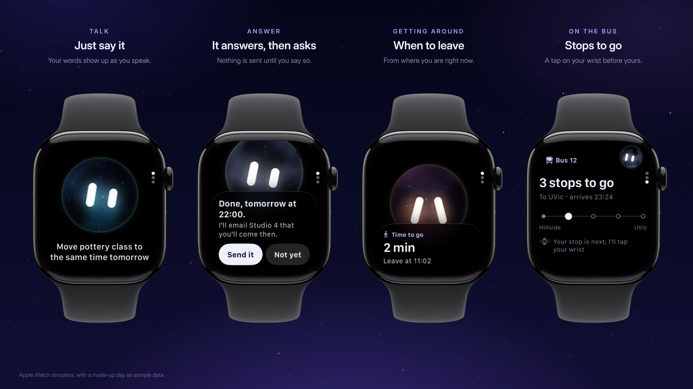

  

<h1 align="center">Ask him about any day of your life.</h1>

  <b>Jarvis</b> is a personal voice AI agent that lives on your own devices and remembers your life.

  
  
  
  
  
  

  

- **He keeps your days.** Where you went, what you worked on, what you said and how you slept, recorded quietly across your devices. Ask *when did I get home on Tuesday?* and the answer links to the moments it rests on.
- **You talk to him.** He is voice-first: say "Hey Jarvis", or tap on the watch, and just talk. Cut in any time, in English or Chinese.
- **He gets things done.** Mail, reminders, buses, web search, your Mac and any app with an MCP server, all done knowing your day.
- **He knows you better every year.** Each night he distills what he learned into one memory of you that grows denser, not longer.
- **He lives at home.** The brain is a Raspberry Pi on your own network; your Mac, iPhone, iPad and Apple Watch are his bodies.

> **Status:** Jarvis is my personal agent. I built him for my own devices and use him every day, and he is still changing quickly. You can't download and install him yet.
>
> **This repository is the showcase.** The source code is private; here are the [website](https://samsara0xgg.github.io/Jarvis/), screenshots and a few of the design records.

## How he gets to know you

What he knows about you is plain text you can read, edit and undo, built up in a loop:

- **He sees your days.** Everything he records is kept as it arrived and never overwritten.
- **He will ask about your life.** A life interview, chapter by chapter, one question at a time, so he learns what no sensor can see. *(Being built.)*
- **He sleeps on it.** Every night he rewrites his memory of you from the day just past, citing where each change came from.
- **He takes your corrections.** When he guesses wrong, your word wins and is never rewritten.

Every section of that memory has a fixed size, so each night it has to merge, sharpen and let go rather than grow; over the years it gets closer to the essence of who you are. It isn't trained into any model, so a better model can read the same memory and know you from its first day.

Models will keep getting better, and everyone will have them; the days you have lived can't be recorded later. I believe a record like this will be one of the most valuable things a person owns, and the best time to start it is now.

What he records, how the interview works, and what happens at night

**What he records**

- **Where you went.** The iPhone keeps every GPS fix while you move and the car's motion while you ride, and turns them into stays, walks, rides and drives.
- **What you were doing.** Your Mac's screen activity, the apps in front on your iPhone and iPad, your calendar, mail, messages, photos (metadata only), Safari history and git commits.
- **Your body.** Sleep, steps, workouts and heart rate from Apple Health.
- **Your words.** Every conversation with Jarvis, and, if you turn it on, the day's audio from the Mac or the phone.
- **Your work with coding agents.** Every session transcript, on your Mac and in the cloud, is kept raw on the brain.
- **Data you export from other services.** Give him an export, such as your claude.ai history or a bank or payment statement, and it joins the same timeline.

Nothing is read until you grant it: each source needs its own permission on the device it comes from. When a source on your Mac that should be producing goes quiet, a card tells you.

**The life interview** *(being built)*

His memory of you begins with a long, unhurried conversation: your story from childhood to now, the people around you, where you want to be in a month, a year and five years, and how you want to be treated.

He asks why and how it felt, not only what happened. Nothing is pushed: a chapter you aren't ready for waits until you bring it up, and a topic you decline is never asked again. Your answers are kept word for word; only the facts you confirm go into his memory, and anything he worked out on his own is labeled as a guess.

**At night**

The memory he rewrites has sections for your story, character and values, body, money, taste, how you want to be treated, the rules you have settled on, documents and hard deadlines, and the people and threads of your life. What you promised and still have to do lives in the list of your things, not in this memory. Each change lands as a new version you can undo, and you can edit any of it on the Memory page. The day itself is kept as a short summary; conversation topics are rebuilt from the day's raw words, never from a summary of a summary.

## Look back on any day

The **Today** page draws your day as one line. Claude reads everything in each stretch and writes what you were doing in a few words, like *Writing the lab report* or *Bus 27 to campus*. The **Map** page replays where you went, with the route, stops, speed and heart rate.

  

## Ask about it

Ask in your own words: *how much did I walk today?*, *what did I tell Mia about the trip?* Every night your talk is filed under topics (a person, a plan, a project), so you can pick one up again weeks later.

## Let him act, knowing you

  

Mail, reminders and bus times are things any assistant can do. Jarvis does them from your own record: he knows where you are right now, what is already on your day, and what you promised and to whom. He asks before anything that goes out or can't be undone, and he never calls something done that isn't.

- **Mail.** He reads your inbox, tells you what needs a reply, drafts the reply as a Gmail draft and sends only after you see every recipient on a card. Bills, due dates and verification codes are picked out for you.
- **Plans and reminders.** He plans the day with you each morning, keeps your appointments, to-dos and bills, and rings on your phone and watch at the right time.
- **Job hunt.** Every application, interview, offer and rejection in one list, kept up from your mail, with a heads-up when an employer writes back.
- **Getting around.** Bus times from BC Transit's real timetable, when to leave, how many stops are left, the weather where you are going, and places nearby.
- **Looking things up.** Quick or deep web search, any page you name, and a photo you send him.
- **Your Mac.** He opens files and links by name, reads your clipboard or your screen, searches your Obsidian notes, and keeps the Mac working overnight with the screen off.
- **Your coding agents.** Claude Code and Codex sessions show beside the Mac notch, and when one wants to run a command you allow or deny it there.
- **Any app.** Gmail, GitHub, Notion and Hue come as plugins, and any other MCP server can be added.

Every tool call ends in a receipt, and code checks what Jarvis says he did against those receipts before he speaks.

## On each device

- **iPhone.** Today, Chat and Map. Press the Action button, say "Hey Jarvis" with the app open, or share anything to Jarvis from another app.
- **Apple Watch.** Tap to talk and read the answer on your wrist. Reminders, "time to leave" and bus progress arrive as cards.
- **iPad.** The same day and chat on a bigger screen, and **Jarvis Remote**: your Mac's screen on the iPad at up to 120 fps, driven by touch, trackpad gestures and voice.
- **Mac.** A small glass ball with eyes beside the notch. He listens, shows your coding agents or the day's timeline, and records what was on your screen.

Say "Hey Jarvis" with several devices around and only one answers: the one you are already talking to, or else the one you touched last.

## Privacy

- **Your data lives on a machine you own.** There is no Jarvis cloud, no telemetry and no update check.
- **Your devices reach it only over your private network** ([Tailscale](https://tailscale.com)). The brain never listens on a public address.
- **What leaves goes only to services you choose:** model providers with your own keys (mainly Claude for thinking, Qwen for hearing your words, MiniMax for his voice), plus what his tools call, such as web search, weather and BC Transit. The spec lists every outgoing request.

## How he's built

One Python brain on the Pi holds memory, the event log, model calls and tools; every other device is one of its bodies ([ADR 0170](docs/adr/0170-one-brain-holds-the-owners-state-and-every-other-device-is-its-terminal.md)). Every decision that moves a boundary is written down as a decision record, more than 400 so far; a few are in [docs/adr](docs/adr).

More on the build

- **Bodies.** Each body keeps its own microphone, wake word, echo cancellation and speaker. The Mac companion is Electron with React and TypeScript plus a small AppKit module for the glass; the iPhone, iPad and watch apps are native SwiftUI. Jarvis Remote streams HEVC from ScreenCaptureKit and VideoToolbox.
- **Models.** Claude by default: Sonnet for conversation, Opus to write what you were doing, Haiku for frequent background analysts. Your words are heard by Qwen's streaming recognizer through the brain, with an on-device recognizer as the fallback (SenseVoice with Silero VAD on the Mac). Wake word on the Mac: microWakeWord. Voice: MiniMax. Storage: SQLite.
- **Four blocks, one place to join them.** Decision, execution, surface and deployment never import one another, over a base of state and shared helpers. Only `runtime/` joins them and it holds nothing else; `lint-imports` and a canary fail the build otherwise.
- **Design notes.** Four engineering stories, with what was measured and the option that lost, are on the [design notes page](https://samsara0xgg.github.io/Jarvis/architecture/design-notes/).

