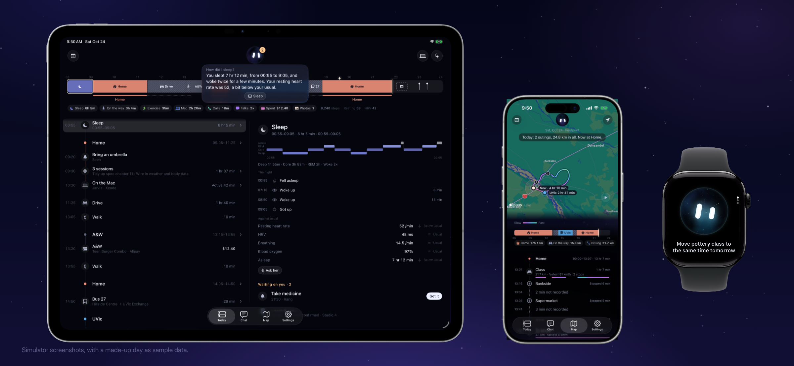
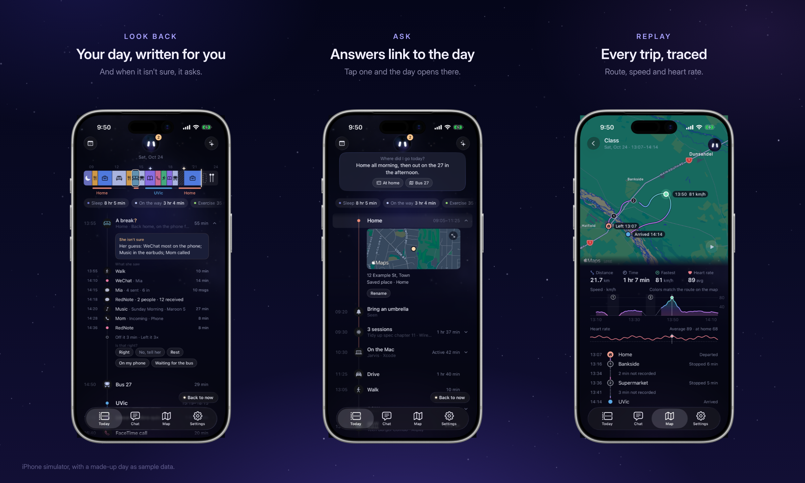

  

<h1 align="center">Ask him about any day of your life.</h1>

  <b>Jarvis</b> is a personal voice AI agent that lives on your own devices and remembers your life.

$\color{silver}\textsf{The source code is temporarily private while I review it for personal data.}$

  <a href="https://samsara0xgg.github.io/Jarvis/"><b>Website</b></a> ·
  <a href="https://samsara0xgg.github.io/Jarvis/features/">Feature tour</a> ·
  <a href="https://samsara0xgg.github.io/Jarvis/architecture/">Architecture</a> ·
  <a href="https://samsara0xgg.github.io/Jarvis/architecture/design-notes/">Design notes</a>

  

- **He keeps your days.** Where you went, what you worked on, what you said and how you slept. Ask *when did I get home on Tuesday?* and the answer links to the moments it rests on.
- **You talk to him.** Say "Hey Jarvis", or tap on the watch, and just talk. Cut in any time, in English or Chinese.
- **He gets things done, knowing you.** Mail, reminders, buses, web search, your Mac and any app with an MCP server.
- **He knows you better every year.** Each night he distills what he learned into one memory of you that grows denser, not longer.
- **He lives at home.** The brain is a Raspberry Pi on your own network; your Mac, iPhone, iPad and Apple Watch are his bodies.

## See more

| | |
|---|---|
| [Look back on any day](https://samsara0xgg.github.io/Jarvis/features/your-day/) | The day drawn as one line, and a map that replays it |
| [How he gets to know you](https://samsara0xgg.github.io/Jarvis/features/memory/) | One memory of you, rewritten every night, that you can read and undo |
| [Let him act](https://samsara0xgg.github.io/Jarvis/features/act/) | Mail, plans, buses and search, with a receipt for every tool call |
| [On each device](https://samsara0xgg.github.io/Jarvis/features/devices/) | iPhone, Apple Watch, iPad and the Mac notch |
| [Privacy](https://samsara0xgg.github.io/Jarvis/features/privacy/) | Your data on a machine you own, reached only over your private network |
| [Design notes](https://samsara0xgg.github.io/Jarvis/architecture/design-notes/) | Four engineering stories, with what was measured and the option that lost |

  

## Decision records

Every decision that moves a boundary is written down as an ADR, with a mandatory "Alternatives rejected" section: more than 400 so far. A few are public here:

- [0170](docs/adr/0170-one-brain-holds-the-owners-state-and-every-other-device-is-its-terminal.md): One brain holds the owner's state, and every other device is its terminal
- [0407](docs/adr/0407-one-device-answers-his-wake-word-named-by-the-brain-before-he-speaks.md): One device answers his wake word, named by the brain before he speaks
- [0319](docs/adr/0319-every-tool-call-ends-in-a-receipt-and-what-tools-did-is-read-only-from-receipts.md): Every tool call ends in a receipt
- [0100](docs/adr/0100-jarvis-yields-to-speech-over-her-and-its-words-decide.md), [0143](docs/adr/0143-echo-cancellation-follows-the-open-microphone.md): Talking over him, and whose echo is cancelled
- [0114](docs/adr/0114-a-structured-spoken-answer-carries-spoken-then-written.md): A spoken answer carries what is said, then what is shown
- [0164](docs/adr/0164-the-decision-snapshot-folds-the-log-from-a-high-water-mark.md), [0165](docs/adr/0165-the-spoken-sample-timeline-drops-provider-silence-at-start-and-junctions.md): Staying fast as he remembers more

How they are written: [docs/adr/README.md](docs/adr/README.md).

---

  Built by Allen Shi · <a href="https://www.linkedin.com/in/yilun-allen-shi-8b1323345/">LinkedIn</a> · <a href="https://samsara0xgg.github.io/Jarvis/">Website</a>

